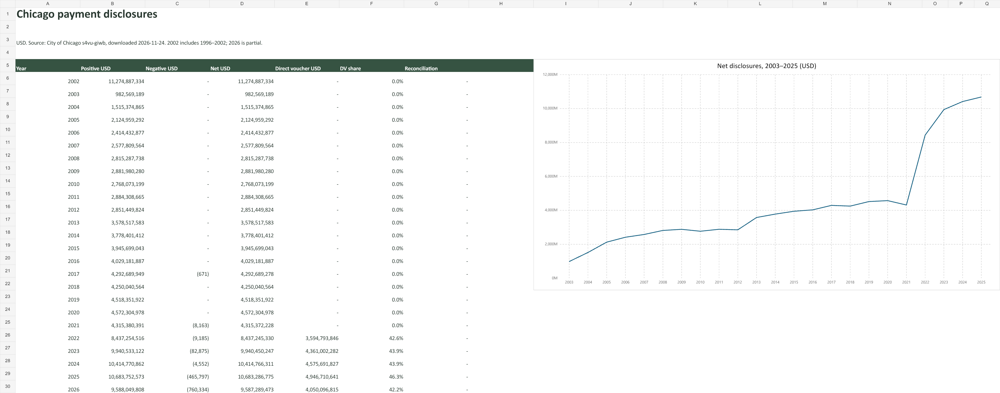

# Chicago Vendor-Payment Analysis & Automation

**489,844 observed payment-disclosure records.** A reproducible analysis of real public data from [City of Chicago Finance — Payments](https://data.cityofchicago.org/d/s4vu-giwb). The default reports use observed records, with no synthetic financial or operational fields.


[Dashboard recording](docs/recordings/walkthrough.mp4) · [Screenshot gallery](docs/screenshots) · [Data provenance](docs/DATA_SOURCE.md)

## What the project demonstrates

Annual disclosures, dated monthly records, vendor-name concentration, direct-voucher share, department completeness and a reproducible exception-review queue. Exact repeated rows are retained and flagged because vouchers do not establish a unique transaction key.

## Run locally

Python 3.10+; standard library only. Compressed source snapshots are checked in, so analysis runs offline.

```sh
python scripts/verify_source.py
python src/run_pipeline.py
python -m unittest discover -s tests -v
```

Open `reports/dashboard.html` in a browser. Generated SQLite databases are excluded from Git to keep the repository compact; running the pipeline recreates them from the full source. No sampled subset is substituted for the full extract.

## Excel and Microsoft assets

[Download the Excel workbook](excel/Chicago_Payment_Review.xlsx). It includes annual reconciliations, the latest-year top 50 vendor names, a native chart and an editable review queue. Formula outputs and a status-change scenario were checked with the artifact workbook engine; native Microsoft Excel execution was not tested.



[Power Query M](excel/LoadReport.pq) and the [manifest JSON schema](automation/manifest_schema.json) are import-ready assets. [Power Automate deployment guide](automation/POWER_AUTOMATE_GUIDE.md) explains worker execution, publication and duplicate-run handling; it is not a deployable flow package. No tenant flows, assignments or notifications were created.

## Analytical scope

Older rows are vendor/contract annual summaries. The year 2002 includes 1996–2002. No invoice due dates, open balances or inventory data exist, so AP aging and stock KPIs were removed. Vendor-name variants are not resolved into legal entities; do not infer duplicate disbursements or fraud. Business Central and Power Automate are documented deployment targets, not connected services.

## Reviewable files

- `data/source/`: compressed full source snapshot, source URL, retrieval timestamp and checksums.
- `src/` and `sql/`: transformations, reporting calculations and local rendering.
- `reports/`: computed summaries, validation results and source-quality evidence.
- `tests/`: edge-case tests for the actual source semantics.
- `docs/`: methodology, screenshots and an automated browser walkthrough.

The earlier synthetic demonstration remains in Git history. Current outputs and screenshots were rebuilt from these public sources; recordings demonstrate the reports, not a person's development session.
