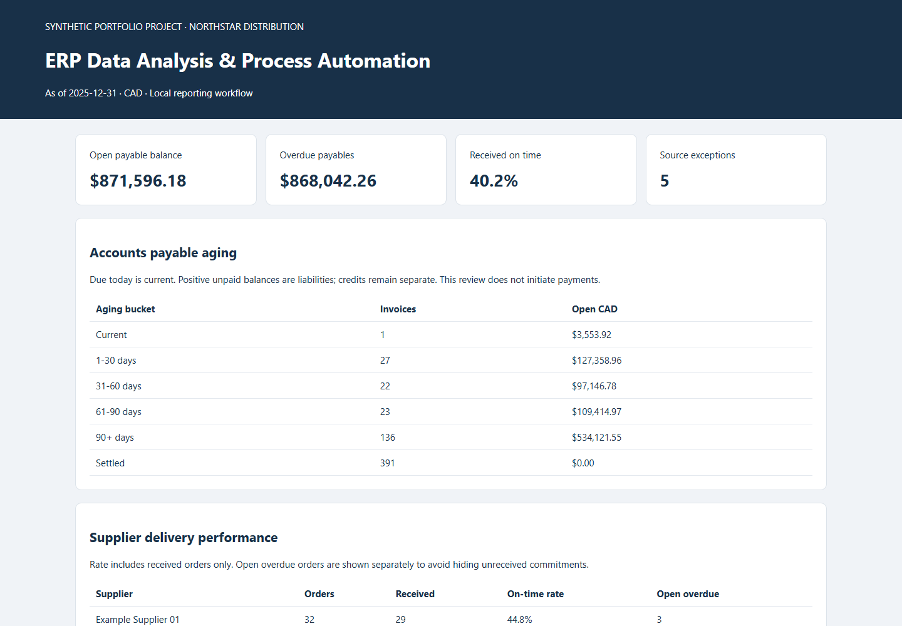
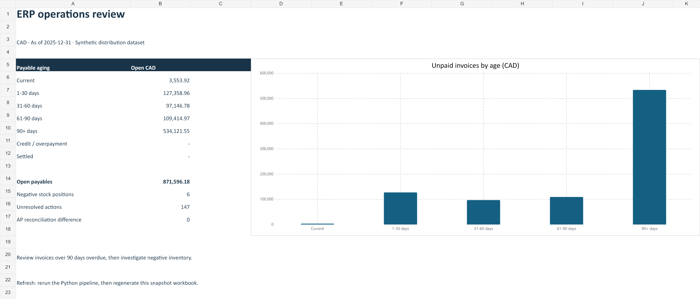

# ERP Data Analysis & Process Automation

A runnable portfolio project analyzing fictional ERP financial, inventory and purchasing records. It demonstrates SQL analysis, repeatable Python validation, local workflow automation, Excel import logic and a Power Automate deployment design.

All records and findings are synthetic. No Business Central tenant was accessed. Excel queries and Power Automate setup require validation in your Microsoft environment; no XLSX or deployable flow package is included.




[Recorded walkthrough](docs/recordings/walkthrough.mp4) · [Screenshot gallery](docs/screenshots) · [Capture details](docs/recordings/capture_manifest.json)

## Open the result

Open `reports/dashboard.html` in a browser. `reports/latest.json` points to the latest successful run folder, containing the management brief, report CSVs, action queue, SQLite database and exception log.

## Reproduce

Python 3.10+ with standard library only. From this folder:

```powershell
python src/generate_data.py
python src/run_pipeline.py
python -m unittest discover -s tests -v
```

The generator deliberately replaces the six synthetic raw extracts; it is a demonstration utility. Normal reruns use only `run_pipeline.py`, preserving input files. The runner supports `--raw`, `--output` and `--as-of YYYY-MM-DD`. The local wrapper is `automation/run_local.ps1`. No schedule is installed.

## Business questions

1. How much remains payable, and which invoices are overdue?
2. Which suppliers deliver late or have overdue open orders?
3. Where do negative stock or low-stock positions need review?
4. Which source defects should be corrected before reporting?

## Outputs

| Folder | Contents |
|---|---|
| data/raw | Six reproducible ERP-style CSV extracts |
| src | Data generator and validating reporting pipeline |
| sql | Payable aging, vendor delivery, inventory and monthly trend views |
| reports | Browser dashboard, latest pointer, immutable successful run folders |
| excel | Typed Power Query importer and workbook assembly instructions |
| automation | Local PowerShell wrapper, manifest schema and cloud-flow blueprint |
| docs | Source mapping, conventions and first-person walkthrough |
| tests | Executable cutoff, reconciliation, duplicate and rerun tests |

Each successful run uses a hash of raw bytes, runner code, SQL and cutoff. Identical input returns the existing run. Changed input produces a new folder; prior runs remain available. Source exceptions are quarantined and business exceptions routed to a local action queue. A missing file or conflicting duplicate fails the run. Run serially; concurrent execution of this prototype is unsupported.

## Scope and limitations

This is management analysis, not a complete ERP or accounting ledger. The stock dataset is independent of purchase orders; no purchase-to-receipt reconciliation is claimed. Dashboard values are a static snapshot of the selected run. Raw CSV imports and cloud integrations must be adapted to real tenant field mappings. No automated messages, ERP changes, payments, real staff assignments, production deployments or measured savings are included.

## Excel workbook

[Download the workbook](excel/ERP_Operations_Review.xlsx) with editable review fields, named tables, formulas and an aging chart. [Workbook details and import instructions](excel/README.md).



Microsoft assets include Power Query M, the Excel workbook and a Parse JSON schema. The Power Automate guide is a deployment blueprint, not an installed or importable flow package.
